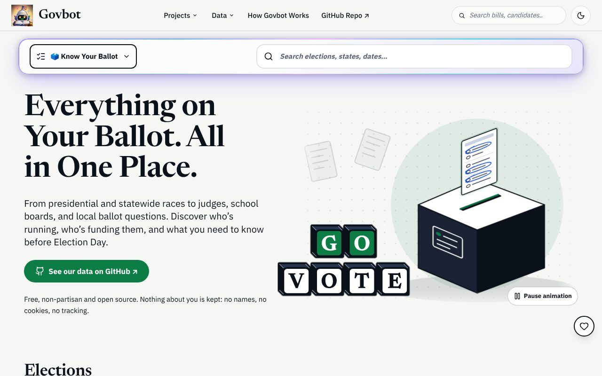
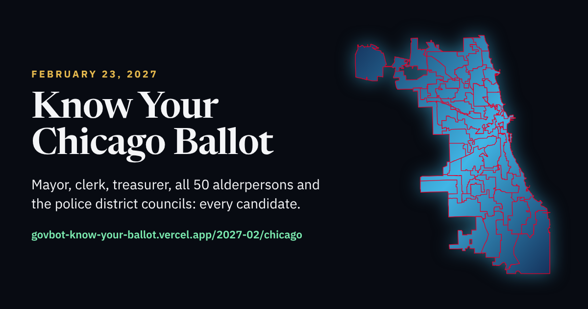
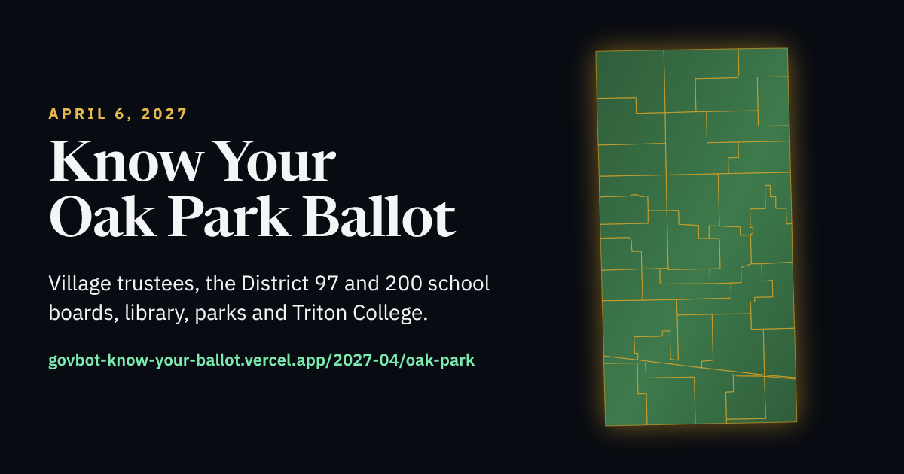
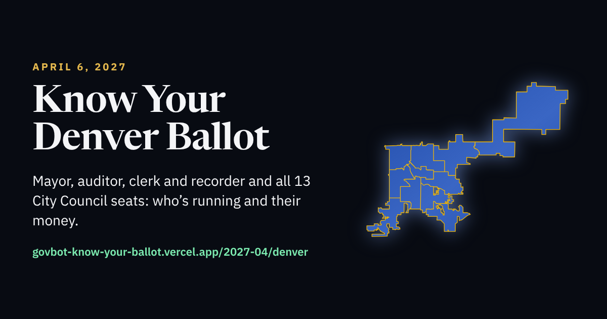
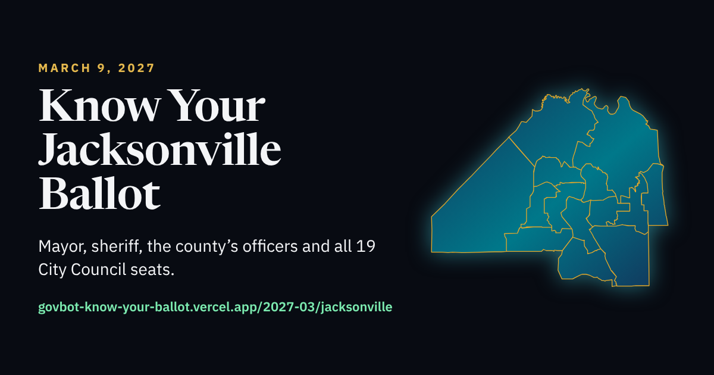
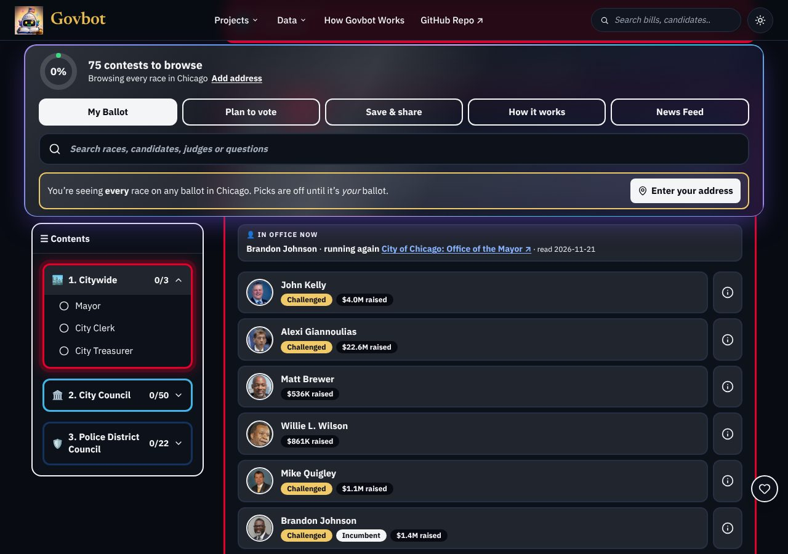
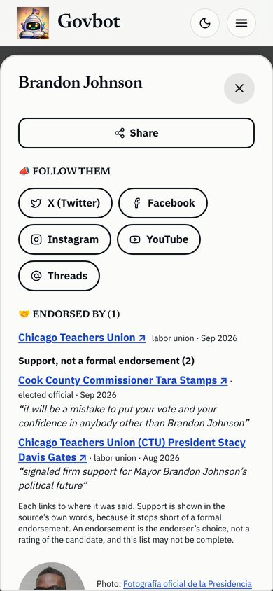
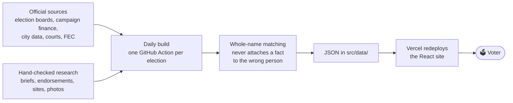

# 🗳️ Govbot Know Your Ballot

**Your exact ballot by address: every race, judge and question explained, who's running and who's funding them.**
Free, open source, nonpartisan. Built on [Govbot](https://chihacknight.github.io/govbot/), Chi Hack Night's open civic data.

[](https://govbot-know-your-ballot.vercel.app)
[](https://github.com/frankies2727/govbot-know-your-ballot/commits/main)
[](https://github.com/frankies2727/govbot-know-your-ballot/labels/good%20first%20issue)
[](https://github.com/frankies2727/govbot-know-your-ballot/labels/new%20state)
[](CONTRIBUTING.md)
[](LICENSE)
[](https://github.com/chihacknight/govbot)

### 👉 [govbot-know-your-ballot.vercel.app](https://govbot-know-your-ballot.vercel.app) 👈

<a href="https://govbot-know-your-ballot.vercel.app"></a>

## ⚡ The short version

- 📍 **Type your address, see your ballot.** Every race you'll vote in, nothing you won't.
- 🧑‍⚖️ **Every race explained.** What the job does, who holds it now, and who's running.
- 💵 **Follow the money.** What each campaign raised and spent, and its top donors.
- 🗣️ **In their own words.** Quotes, endorsements and survey answers, each one linked to its source.
- 🔒 **Private.** Your picks stay in your browser. No accounts, no cookies, no analytics.
- ⚖️ **Nonpartisan.** We never rate, rank or recommend. Every fact names its source.

## 🗓️ Elections

<table>
<tr>
<td width="50%"><a href="https://govbot-know-your-ballot.vercel.app/2027-02/chicago"></a></td>
<td width="50%"><a href="https://govbot-know-your-ballot.vercel.app/2027-04/oak-park"></a></td>
</tr>
<tr>
<td width="50%"><a href="https://govbot-know-your-ballot.vercel.app/2027-04/denver"></a></td>
<td width="50%"><a href="https://govbot-know-your-ballot.vercel.app/2027-03/jacksonville"></a></td>
</tr>
</table>

| | Election | Election Day | Guide | Data |
|---|---|---|---|---|
| 🟢 | **Chicago** city election: mayor, clerk, treasurer, all 50 alderpersons, police district councils | Feb 23, 2027 (runoffs Apr 6) | [/2027-02/chicago](https://govbot-know-your-ballot.vercel.app/2027-02/chicago) | [](https://github.com/frankies2727/govbot-know-your-ballot/actions/workflows/kyb-2027-02-chicago.yml) |
| 🟢 | **Jacksonville** city election: mayor, sheriff, county officers, city council | Mar 9, 2027 (runoffs May 18) | [/2027-03/jacksonville](https://govbot-know-your-ballot.vercel.app/2027-03/jacksonville) | [](https://github.com/frankies2727/govbot-know-your-ballot/actions/workflows/kyb-2027-03-jacksonville.yml) |
| 🟢 | **Denver** municipal election: mayor, auditor, clerk and recorder, city council | Apr 6, 2027 (runoffs Jun 1) | [/2027-04/denver](https://govbot-know-your-ballot.vercel.app/2027-04/denver) | [](https://github.com/frankies2727/govbot-know-your-ballot/actions/workflows/kyb-2027-04-denver.yml) |
| 🟢 | **Oak Park** consolidated election: village trustees, school boards 97 and 200, library, parks, Triton College | Apr 6, 2027 | [/2027-04/oak-park](https://govbot-know-your-ballot.vercel.app/2027-04/oak-park) | [](https://github.com/frankies2727/govbot-know-your-ballot/actions/workflows/kyb-2027-04-oak-park.yml) |
| 🟢 | **Wisconsin** spring election: Supreme Court, Court of Appeals, circuit courts | Apr 6, 2027 (primary Feb 16) | [/2027-04/wisconsin](https://govbot-know-your-ballot.vercel.app/2027-04/wisconsin) | [](https://github.com/frankies2727/govbot-know-your-ballot/actions/workflows/kyb-2027-04-wisconsin.yml) |
| 📜 | **Illinois** midterm: every contest on a Chicago or suburban Cook ballot, judges included, with results | Nov 3, 2026 | [/2026-11/illinois](https://govbot-know-your-ballot.vercel.app/2026-11/illinois) | [](https://github.com/frankies2727/govbot-know-your-ballot/actions/workflows/kyb-2026-11-illinois.yml) |
| 📜 | **Michigan** midterm: governor, U.S. Senate, Congress, Lansing, courts, university boards, proposals | Nov 3, 2026 | [/2026-11/michigan](https://govbot-know-your-ballot.vercel.app/2026-11/michigan) | [](https://github.com/frankies2727/govbot-know-your-ballot/actions/workflows/kyb-2026-11-michigan.yml) |
| 📜 | **Minnesota** midterm: governor, U.S. Senate, Congress, St. Paul, courts, the school-fund amendment, with results | Nov 3, 2026 | [/2026-11/minnesota](https://govbot-know-your-ballot.vercel.app/2026-11/minnesota) | [](https://github.com/frankies2727/govbot-know-your-ballot/actions/workflows/kyb-2026-11-minnesota.yml) |
| 📜 | **Wisconsin** midterm: governor, Congress, the Legislature, three constitutional questions | Nov 3, 2026 | [/2026-11/wisconsin](https://govbot-know-your-ballot.vercel.app/2026-11/wisconsin) | [](https://github.com/frankies2727/govbot-know-your-ballot/actions/workflows/kyb-2026-11-wisconsin.yml) |

🟢 upcoming · 📜 past, kept as the record with who won.

**Want your city or state?** Read [CONTRIBUTING.md](CONTRIBUTING.md) and open a [new-state issue](.github/ISSUE_TEMPLATE/new-state.md).

## 👀 What a voter sees

<table>
<tr>
<td width="68%"></td>
<td width="32%"></td>
</tr>
<tr>
<td align="center"><sub>Every race, with photos, status and money (dark mode)</sub></td>
<td align="center"><sub>A candidate's profile on a phone</sub></td>
</tr>
</table>

| | What you get |
|---|---|
| 📍 | **Your ballot.** Enter an address, or browse every race without one. |
| 🏛️ | **Each race.** What the job does, who holds it now ("In office now") and, when they aren't running, why. |
| 🙋 | **Each candidate.** Photo, filing status, background and priorities, quotes in their own words, campaign site and social accounts. |
| 🤝 | **Endorsements and support.** Each one is linked and dated. "Firm support" is shown separately from formal endorsements. |
| 💵 | **Money.** Raised, spent, cash on hand and top donors. Federal races also show outside spending for and against. |
| 📊 | **Records.** Bills sponsored, Chicago City Council attendance and votes, and judges' bar ratings. |
| ⚖️ | **Compare.** See candidates side by side, full profiles included. |
| 🗓️ | **Plan to vote.** Key dates, early voting and mail ballots. |
| 💾 | **Save and share.** Print or download your picks as a PDF, and share a progress card (never your picks). |
| 🔗 | **Link to anyone.** Every candidate has their own page: `/2027-02/chicago/candidates/mayor/brandon-johnson`. |
| 🗞️ | **News Feed.** News, official notices, campaign sites, finances, social posts, bills and key dates, each filterable. |
| 🏁 | **Results.** Once the count is in, the Illinois and Minnesota guides show who won. |
| 🌗 | **Light and dark**, phone and desktop. **Report a mistake** on every card. |

> **The one rule:** everything shown comes from an official or documented public source named next to it. Nothing is summarized, rated or editorialized by us. A candidate's words are quoted verbatim, with the date and a link.

## 🧭 How it works



The site is a React + Vite app. Node scripts rebuild each election's data every morning in GitHub Actions and commit it, and Vercel redeploys from `main`. Two small Vercel functions run beside it: one files "Report a mistake" forms as GitHub issues, and one runs the anonymous live count. There are no keys in the browser and no analytics.

<details>
<summary><b>📁 Where things live</b></summary>

```
src/                    the app; src/guide/ is the shared guide, src/<guide>/ what differs per election
                        (src/chicago-2027/, src/oak-park-2027/, src/michigan/ …); src/KnowYourBallot.tsx is Illinois
src/data/<guide>/       the published data: ballot.json (races, candidates, incumbents), briefs, districts
src/govbot/             Govbot's header, footer and stylesheet, copied by scripts/govbot-shell.mjs
src/seo/                the FAQ and copy shared by the page, its search-engine text and its structured data
scripts/                the daily builds: illinois.mjs, state.mjs (+ <state>/config.mjs), <guide>.mjs for the
                        2027 guides, briefs.mjs, and the modules they share (illinois/* is the original set)
scripts/<guide>/        hand-checked inputs: briefs.json, endorsements.json, support.json, sites.json, photos
scripts/audit.mjs       reconciliation, the last step of the November 2026 state builds
scripts/seo/            llms.txt, sitemap and one prerendered page per candidate
api/                    report.ts (Report a mistake → GitHub issue) and pulse.ts (the live count)
public/kyb-photos/      candidate photos, each credited and linked in the app
.github/workflows/      one daily data workflow per election, kyb-<YYYY-MM>-<place>.yml, so each can be run or
                        paused on its own; kyb-site.yml refreshes the govbot shell and badges; ci.yml checks PRs
.github/actions/        kyb-setup (Node + only the tools a build needs) and kyb-commit (commit, retrying on conflicts)
```
</details>

## 🛠️ Run it locally

```bash
npm install
npm run dev          # the site at http://localhost:5173
npm run lint         # type-check
npm run build        # production build (dist/)
npm run test:data    # offline tests of the data parsers
```

**Rebuild one election's data** (what its daily workflow runs):

| Election | Command | Needs |
|---|---|---|
| 2026-11 Illinois | `npm run data:illinois` | `pdftotext` (poppler-utils), ImageMagick, `npm install --no-save playwright` |
| 2026-11 Michigan / Minnesota / Wisconsin | `npm run data:michigan` (or `minnesota`, `wisconsin`) | `unzip`, `curl`, ImageMagick |
| 2027-02 Chicago | `node scripts/chicago-2027.mjs` | `pdftotext`, ImageMagick |
| 2027-03 Jacksonville / 2027-04 Denver | `node scripts/jacksonville-2027.mjs` (or `denver-2027.mjs`) | nothing extra |
| 2027-04 Oak Park | `node scripts/oak-park-2027.mjs` | nothing extra (`ISBE_DIR=<dir>` reuses downloaded State Board files) |
| 2027-04 Wisconsin | `node scripts/wisconsin-2027.mjs` | `pdftotext` once the official list is in |

Every step is **fail-soft**: a source that can't be read today keeps yesterday's data for that field, and the log says so.

### 🔄 The daily refresh

Each election has its own workflow in `.github/workflows/`, named `kyb-<YYYY-MM>-<place>.yml` (e.g. `kyb-2027-02-chicago.yml`). They run every morning a few minutes apart, and each commits only its own election's data. To pause one, open **Actions → the workflow → Disable workflow**; **Run workflow** runs it by hand. `kyb-site.yml` runs after them all and refreshes the shared Govbot shell and these badges.

## 📚 Where the data comes from

<details>
<summary><b>🟢 2027-02 Chicago</b></summary>

- **Who's running:** the Chicago Board of Election Commissioners' candidate list ("Candidate Filings in Ballot Order", a PDF): names in ballot order, each with its filing status.
- **Who holds each seat:** the City's ward offices (Chicago Data Portal, with the City Clerk's photo of each alderperson), the CCPSA's page for each police district council, and the City's pages for the mayor, clerk and treasurer. Sitting alderpersons carry their council record (attendance, ordinances introduced, budget votes).
- **Campaign money and donors:** the Illinois State Board of Elections' bulk files, including the itemized receipts that name each candidate's donors.
- **Briefs, endorsements, support, sites and photos:** read by hand from the candidate's own pages and the press. Every line has its source, and quotes are checked against the page (`scripts/chicago-2027/*.json`, `scripts/briefs.mjs`).
- **Petition counts:** a link to each candidate's page on Chicago Politics, when its sitemap lists one.
</details>

<details>
<summary><b>🟢 2027-03 Jacksonville</b></summary>

- **Seats and dates:** the Duval County Supervisor of Elections.
- **Who holds each seat:** the City Council's members page and the county officers' own pages. Council districts come from the City's JaxGIS map.
- **Who's running:** candidates qualify Jan 11–15, 2027. Until then the mayor's race lists who has filed or announced, from the Wikipedia article on it (which cites the Supervisor), each marked as not yet qualified.
</details>

<details>
<summary><b>🟢 2027-04 Denver</b></summary>

- **Who's running and their money:** SearchLight, the City's campaign finance system: everyone who registered a committee for 2027, with totals since Jan 1, 2024 and Fair Elections Fund matching shown on its own. Registering isn't making the ballot; petitions are due Jan 21, 2027.
- **Council districts and who holds each seat:** the City's council district map (Denver Open Data). The mayor, auditor and clerk and recorder come from the City's own pages.
</details>

<details>
<summary><b>🟢 2027-04 Oak Park</b></summary>

- **The offices:** each body's own notices and rosters (Village, District 97, District 200, Library, Park District, Triton College).
- **Who's running and their money:** the State Board of Elections' candidate files, read daily, with each committee's reports and donors since Jan 1, 2025. Someone the Wednesday Journal reports as running who isn't on file yet is listed as "Announced", with the article.
- **The map:** the village's 32 precincts, from Cook County GIS. Every race is nonpartisan, with no primary.
</details>

<details>
<summary><b>🟢 2027-04 Wisconsin spring</b></summary>

- **The contests:** the Supreme Court seat Justice Annette Ziegler is leaving, a seat in each Court of Appeals district, and the circuit court seats up this spring.
- **Who's running:** until the Elections Commission's "Candidates on Ballot" list is out, the Wikipedia articles on the 2027 elections, with announced candidates marked as such. Then a copy of the Commission's list in `scripts/wisconsin-2027/official/` replaces them, in ballot order.
</details>

<details>
<summary><b>📜 2026-11 Illinois</b></summary>

- **Who's on the ballot:** the Chicago Board of Elections candidate list (every contest on any Chicago ballot, in ballot order, plus judicial retentions and referenda), parsed from its PDF. Suburban Cook adds the State Board of Elections' certified list for the congressional, legislative and judicial districts outside Chicago. The four all-suburban County Board districts, suburban referenda and suburban ballot numbers come from the Cook County Clerk, whose site blocks automated downloads; the app tells suburban voters exactly what's missing for their address.
- **Campaign money:** FEC bulk filings for federal candidates, and the State Board of Elections' bulk disclosure files for state and local ones. A name only gets numbers when the whole name matches one person running for the same kind of office.
- **Photos, websites and social accounts:** official sources first (Congress portraits, the General Assembly's photos via Open States, Wikidata and Wikimedia Commons, campaign sites, hand-picked photos). Anyone still missing something gets it from their Ballotpedia profile (only when the page is theirs; through a headless browser when Ballotpedia's firewall answers with a challenge, `scripts/browser.mjs`), then from their own campaign site (a face-checked headshot, `scripts/headshots.mjs`).
- **Judges:** Injustice Watch's judicial election guide (CC BY-ND): each judge's photo, every bar group's rating and the whole profile, word for word. The Alliance of Bar Associations adds each group's rating of the contested seats. Vacancies carry the reason and date from the Illinois Courts' official list.
- **Who's in office now, and why they're leaving:** Open States' roster (via Govbot) or the Wikipedia article on the race. Whether they're on the ballot is read from the candidate lists, never from prose. Candidates who already sit in Springfield or Congress carry the bills they sponsored, from Govbot.
- **In their words and endorsements:** Ballotpedia's Candidate Connection survey (verbatim, with the date), the candidate's own "Issues" page, the Wikipedia article's endorsement lists, and the Sun-Times / WBEZ questionnaire for school board candidates.
- **Your districts:** the address goes once to Cook County's address locator; district maps are pre-baked, so matching happens on the device. Any of the 102 counties can be browsed without an address.
</details>

<details>
<summary><b>📜 2026-11 Michigan</b></summary>

- **Who's on the ballot:** Ballotpedia's race pages and Wikipedia's articles for the three university boards (both CC BY-SA, linked in the app). The Secretary of State's certified listing refuses automated readers; swap it in (`scripts/michigan/ballotpedia.mjs`) when that changes.
- **Campaign money:** the FEC, and the Michigan Transparency Network's nightly exports for state and local races.
- **Photos, who's in office, in their words, endorsements, records:** the same steps as Illinois (`scripts/state.mjs` with `scripts/michigan/config.mjs`).
- **Proposals:** both statewide proposals in their certified wording, with a plain-English note.
- **Your districts:** Photon (OpenStreetMap; Nominatim as fallback) and pre-baked Census maps.
- **Not here:** county and local offices, trial-court judges, local proposals. The app points voters to Michigan.gov/Vote.
</details>

<details>
<summary><b>📜 2026-11 Minnesota</b></summary>

- **Who's on the ballot:** the Secretary of State's candidate filings decide who is on each ballot (`scripts/minnesota/filings.mjs`), with Ballotpedia's race pages for spelling and running mates. The 114 district court seats come only from the filings (`scripts/minnesota/courts.mjs`).
- **Campaign money:** the FEC, and the Campaign Finance Board for state races (`scripts/minnesota/cfb.mjs`).
- **The amendment:** the permanent-school-fund amendment in its ballot wording, with a plain-English note, including that a blank counts as a no.
- **Results:** the Secretary of State's results files, matched to our races (`scripts/results.mjs`).
- **Not here:** county and local offices, school boards, local questions. The app points voters to the Minnesota Voter Information Portal.
</details>

<details>
<summary><b>📜 2026-11 Wisconsin</b></summary>

- **Who's on the ballot:** the Elections Commission's "Candidates on Ballot by Election" list (`scripts/wisconsin/official/*.pdf`, read by `scripts/wisconsin/official.mjs`) decides who is on each ballot, with Ballotpedia's race pages for spelling. The Commission's site turns scripted readers away, so the PDF is saved in the repo by hand.
- **Campaign money:** the FEC, and the Ethics Commission's campaign finance system (`scripts/wisconsin/sunshine.mjs`).
- **The questions:** the three constitutional amendments in their ballot wording, each with a plain-English note.
- **Not here:** county offices and local referendums. The app points voters to MyVote Wisconsin.
</details>

<details>
<summary><b>💸 Outside spending (federal races)</b></summary>

Every federal candidate with an FEC id also carries what outside groups spent for and against them this cycle (`scripts/illinois/fec.mjs`, from the FEC's bulk file of committee transactions: 24E rows support a candidate, 24A ones oppose). These are the FEC's processed filings, so they lag the 24/48-hour reports by a few days.
</details>

<details>
<summary><b>🧹 Reconciliation (the November 2026 state builds)</b></summary>

`scripts/audit.mjs` is the last step before a ballot is written. Anything attached to a candidate whose source names someone else is dropped and logged: a portrait or site for someone who isn't that legislator, a Ballotpedia page with another name, or a site, account, photo or money id that two candidates share. Upstream, a match needs the whole name (and office, district, state), never the surname alone. Run it by hand: `npm run audit -- il` (or `mi`, `mn`, `wi`; add `--write` to apply).
</details>

## 🔒 Privacy

- 📍 Your **address** goes once to the public address locator named in the app, and nowhere else.
- 💾 Your **picks, plans and progress** stay in your browser's local storage. The share card shows progress, never picks.
- 🚫 **No analytics, no cookies, no accounts.**
- 💗 The **live count** is anonymous. A tab's random id lives in memory only, and the one thing kept about a connection is a keyed hash of its address, which expires within the hour.

## 🛎️ Reports from readers

Every race, candidate, judge and measure has a **Report a mistake** link. It opens a short form (what it shows, what's correct, a source link), and `api/report.ts` files it as a GitHub issue labelled `wrong-information`, so a reader needs no GitHub account. Spam protection is a hidden honeypot field, a minimum fill time, length and link checks, and a per-address limit.

**Setup:** set one secret in Vercel (Settings → Environment Variables): `GITHUB_REPORT_TOKEN`, a fine-grained token with **Issues: read and write** on this repository only. Without it, the form offers GitHub's own issue form instead.

<details>
<summary><b>🔎 Search engines and AI assistants</b></summary>

What a crawler or AI assistant reads is built from the same sourced data and copy the app shows.

- **Files:** `robots.txt` (AI crawlers welcome, `/api/` kept out), `sitemap.xml` (each page's `lastmod` is its candidate list's own date), `llms.txt` and `llms-full.txt`. The Vite plugin in `vite.config.ts` writes them from `scripts/seo/`.
- **A page per candidate:** `scripts/seo/candidate-pages.ts` prerenders every candidate's facts (money, quotes, endorsements, record, sources) at `/<guide>/candidates/<race>/<name>`, and the app opens their card there.
- **Text in each page:** `scripts/seo/page-body.ts` writes readable text into each guide page before the app loads (dates, races, what each office does, FAQs). The app's first render replaces it: the same facts, never hidden text.
- **One copy of the words:** `src/seo/faq.ts` builds every question from the ballot data, and the same function feeds the visible "FAQs", the page text and the FAQ markup, so they can't disagree.
- **Check it:** after `npm run build`, `npx esbuild scripts/seo-test.mjs --bundle --platform=node --format=esm --outfile=/tmp/seo-test.mjs && node /tmp/seo-test.mjs`.
</details>

<details>
<summary><b>💗 The live count and the heart</b></summary>

Every page floats a message, "N people have used the Govbot guide to vote more informed · N here now", and a heart. Each tap of the heart sends up a burst of hearts and one of 300-odd encouraging or funny nonpartisan lines (`src/heartLines.ts`). The heart isn't counted or sent anywhere.

N counts distinct browser tabs that opened the guide (a HyperLogLog in Redis), polled by `src/Pulse.tsx` from `api/pulse.ts` every 25 seconds while the tab is visible. It counts people who opened the guide, not who voted. The store is a Redis connected to the Vercel project: Upstash (`KV_REST_API_URL` + `KV_REST_API_TOKEN`) or Vercel's own Redis (`REDIS_URL`). With no store connected, the message isn't drawn but the heart still is. Test it offline: `node --experimental-strip-types scripts/pulse-test.mjs`.
</details>

## 🙌 Contributing

Bug reports, corrections and new places are all welcome; see [CONTRIBUTING.md](CONTRIBUTING.md). Wrong information about a real person is fixed first: use the [wrong-information issue template](.github/ISSUE_TEMPLATE/wrong-information.md).

## 📄 Licence

Code: [MIT](LICENSE). The data files are compiled from the public sources named above and in the app's Sources section, each under its own terms (government records; Ballotpedia and Wikipedia, CC BY-SA; Injustice Watch, CC BY-ND; Open States, CC0). Candidate photos are credited and linked to their source in the app.
